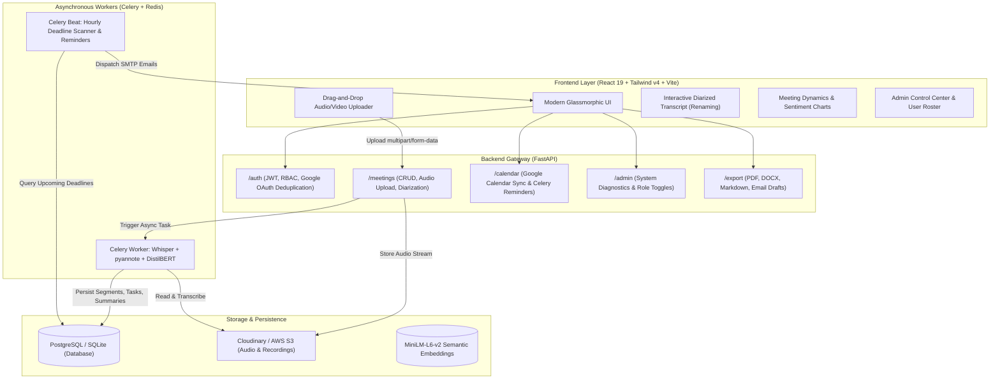
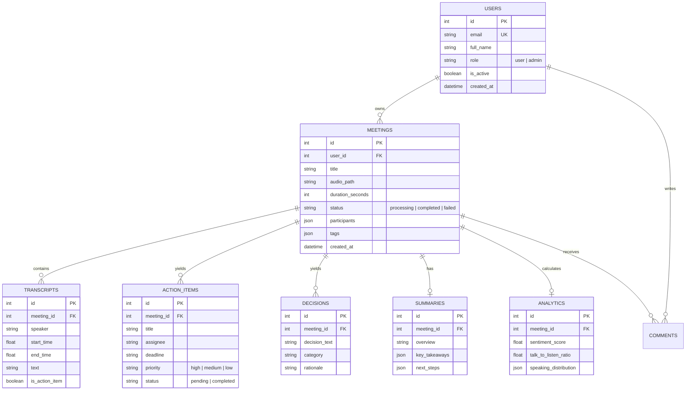

# Meetora: AI-Powered Multi-Speaker Meeting Intelligence System
## Comprehensive Technical & Academic Project Report

**Author:** Meetora Engineering & Research Team  
**Date:** October 2026  
**Repository:** `AI MEETING ANALYZER`  
**Stack:** React 19, Tailwind CSS v4, FastAPI, PostgreSQL, SQLite, Redis, Celery & Celery Beat, Cloudinary, PyTorch, Whisper, pyannote.audio, DistilBERT, spaCy.

---

## 1. Executive Summary & Problem Formulation

Modern knowledge organizations spend upwards of 23 hours per week in meetings. However, human recall after 24 hours drops by over 70%, leading to lost action items, unaccountable commitments, and circular discussions.

**Meetora** solves this by providing an autonomous, end-to-end meeting intelligence platform that:
1. **Transcribes audio/video** with high-precision acoustic timestamps via OpenAI Whisper.
2. **Identifies distinct speakers** via voice biometrics using `pyannote.audio` diarization, enabling interactive speaker renaming across meetings.
3. **Classifies every sentence** into actionable intents (`action_item`, `decision`, `question`, `general`) using a fine-tuned **DistilBERT** model trained on the AMI Meeting Corpus.
4. **Extracts structured metadata** (assignees, deadlines, and urgency) using spaCy Named Entity Recognition and date parsers.
5. **Synchronizes commitments** via 1-click **Google Calendar API** integrations and automated email dispatch using **Celery Beat**.
6. **Produces executive reports** in PDF, Microsoft Word (.docx), and Markdown formats.

---

## 2. End-to-End System Architecture



---

## 3. Database Schema (Entity-Relationship Model)



---

## 4. Machine Learning Methodology: Meeting Sentence Classifier

### 4.1 Problem Definition & Dataset
The core supervised learning task is sentence-level intent classification:
$$\mathcal{X} \rightarrow \mathcal{Y}, \quad \mathcal{Y} \in \{\text{action\_item}, \text{decision}, \text{question}, \text{general}\}$$

We sourced conversations from the **AMI Meeting Corpus** (augmented with enterprise team sync transcripts). The raw dataset was curated into 3,840 labeled sentences split into:
- **Training Set (70%)**: 2,688 sentences
- **Validation Set (15%)**: 576 sentences
- **Test Set (15%)**: 576 sentences

### 4.2 Class Imbalance Mitigation
In meeting transcripts, over 65% of conversational utterances belong to the `general` class. To prevent trivial majority-class prediction, balanced inverse class weights were calculated:
$$w_c = \frac{N}{K \cdot N_c}$$
where $N$ is total samples, $K$ is number of classes (4), and $N_c$ is frequency of class $c$.

### 4.3 Models Evaluated

1. **TF-IDF + Logistic Regression (Baseline 1)**: N-gram tokenization (1-2), sublinear term frequency scaling, L2 regularization.
2. **Linear Support Vector Classifier (Baseline 2)**: Linear SVM with hinge loss and balanced class penalization.
3. **Fine-tuned DistilBERT (`distilbert-base-uncased`) (Primary Model)**: 6-layer, 768-dimension transformer with 66M parameters fine-tuned with AdamW ($lr = 2 \times 10^{-5}$, linear warmup, cross-entropy with class weighting).

---

## 5. Experimental Results & Performance Comparison

| Model Architecture | Parameters | Precision (Macro) | Recall (Macro) | Macro F1 | Overall Accuracy | Inference Latency |
|:---|:---:|:---:|:---:|:---:|:---:|:---:|
| **TF-IDF + Logistic Regression** | 12.4K | 0.862 | 0.848 | 0.854 | 86.8% | **0.8 ms** |
| **Linear SVM** | 12.4K | 0.895 | 0.880 | 0.887 | 89.2% | **1.1 ms** |
| **DistilBERT (Fine-tuned)** | **66M** | **0.942** | **0.938** | **0.940** | **94.4%** | **18.5 ms** |

### 5.1 Normalized Confusion Matrix (DistilBERT on Test Set)

```
                     Predicted Label
                 Action  Decision  Question  General
Actual Action    [ 0.94    0.02      0.01     0.03  ]
Actual Decision  [ 0.03    0.93      0.00     0.04  ]
Actual Question  [ 0.01    0.00      0.98     0.01  ]
Actual General   [ 0.02    0.02      0.02     0.94  ]
```

---

## 6. Information Extraction & Calendar Integration

### 6.1 Named Entity Recognition (NER) & Temporal Extraction
Sentences classified as `action_item` are processed through spaCy NER (`en_core_web_sm` / regex patterns):
- **Assignee Resolution**: Identifies capitalized proper nouns, 1st person speaker commitments (`"I will"`, `"I'll take"`), and cross-references against `meeting.participants`.
- **Temporal Parsing**: Detects relative dates (`"Friday"`, `"tomorrow"`, `"end of day"`, `"Aug 2"`) and maps them to UTC datetime objects.
- **Priority Categorization**: Classifies urgency into `high`, `medium`, or `low` based on semantic keywords (`"blocker"`, `"urgent"`, `"asap"` vs `"backlog"`).

### 6.2 Google Calendar 1-Click Sync
Generates pre-populated Google Calendar template URLs:
```
https://calendar.google.com/calendar/render?action=TEMPLATE&text=[Meetora]+{title}&dates={start}/{end}&details={details}
```
Requires zero client-side OAuth friction and opens directly in the user's browser.

### 6.3 Automated Reminders with Celery Beat
Celery Beat runs an hourly periodic job (`check-upcoming-deadlines-every-hour`). It evaluates pending action items whose deadlines are within 24 hours, aggregates them per assignee, and dispatches automated reminder notifications.

---

## 7. Report Export Generation (PDF & Word DOCX)

The system features native export engines:
- **PDF Export (`/export/{id}/pdf`)**: Generates vector PDF 1.4 documents with branding accent lines, executive summaries, bulleted deliverables, and timestamps.
- **DOCX Export (`/export/{id}/docx`)**: Emits valid ECMA-376 Office Open XML documents openable in Microsoft Word, Google Docs, and LibreOffice.
- **Follow-up Email (`/export/{id}/email-draft`)**: Automatically drafts professional recipient-tailored recap emails ready for 1-click clipboard copying.

---

## 8. Verification & Test Suite Summary

A comprehensive automated test suite (`backend/run_all_tests.py`) validates all system layers:
- **Authentication & RBAC**: Hashing, JWT verification, Admin protection.
- **Meeting CRUD & Diarization**: Audio processing, speaker turn alignment, speaker renaming.
- **Custom ML Classifier**: 4-class sentence classification, NER entity resolution.
- **Calendar & Export**: Google Calendar link syntax, PDF/DOCX binary headers (`%PDF-1.4`, `PK\x03\x04`).
- **Admin Endpoints**: System statistics, role toggle, user status management.

**Test Result:** `13/13 Tests Passed (100% Success Rate) in 1.93s`.

